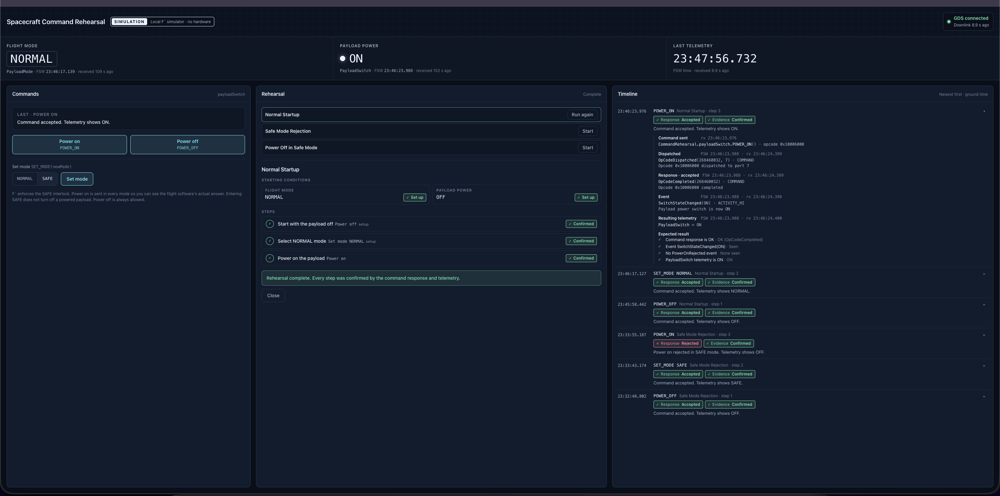

# Spacecraft Command Rehearsal Lab

An operator console for rehearsing spacecraft commands against real flight software, run locally as a
simulation. It sends commands to NASA JPL's [F´ (F Prime)](https://fprime.jpl.nasa.gov) flight software
through the F´ ground data system (GDS), and shows what the flight software actually did.

What the console demonstrates:

- **The interlock lives in the flight software.** The console sends Power on in SAFE mode too. F´ rejects it with
  `OpCodeError(EXECUTION_ERROR)` and a `PowerOnRejected(SAFE)` event, and telemetry shows the payload stays OFF.
- **Evidence, not assumptions.** A rehearsal step is Confirmed only when the actual command response and the
  telemetry that follows match the expected result. Missing evidence shows as Unconfirmed, and the operator
  decides whether to send again.
- **Honest state.** Flight mode and payload power read Unknown until telemetry reports them, and Last known after
  the link drops.



*The F´ simulator accepts POWER_ON in NORMAL and rejects it in SAFE. Telemetry confirms the payload turns ON in NORMAL and stays OFF in SAFE.*

After [setting up](#set-up) and [building](#build), start it with `scripts/console.sh` and open
http://127.0.0.1:8765. See [Operator console](#operator-console) for the walkthrough.

Under the console is a local F´ deployment built from the F´
[Hello World tutorial](https://fprime.jpl.nasa.gov/latest/tutorials-hello-world/docs/hello-world/). It has one
simulated payload power switch with `NORMAL` and `SAFE` modes, plus unit tests and GDS integration tests. Nothing here
drives hardware or talks to anything off this machine. The "switch" is a state variable inside the flight software,
and every listener binds to `127.0.0.1`.

## What's in the project

| Path | What it is |
|---|---|
| `lib/fprime/` | F´ framework **v4.4.0**, as a git submodule. This is the version the Hello World tutorial is tested against. |
| `CommandRehearsal/Components/HiComponent/` | The tutorial's component: the `SAY_HI` command, `SayHiEvent` event and `GreetingCount` channel, exactly as the tutorial writes it |
| `CommandRehearsal/Components/PayloadPowerSwitch/` | The simulated payload power switch (see below) |
| `CommandRehearsal/RehearsalDeployment/` | The deployment: the tutorial's standard command and data handling topology plus `hiCmpntInstance` (base id `0x10005000`) and `payloadSwitch` (base id `0x10006000`) |
| `CommandRehearsal/Components/PayloadPowerSwitch/test/ut/` | The switch's unit tests (F´ Google Test harness) |
| `CommandRehearsal/RehearsalDeployment/test/int/` | The pytest integration tests, run through the F´ GDS |
| `scripts/integration-test.sh` | Starts the deployment and GDS headless, runs the integration tests, then stops everything |
| `console/` | The operator console: a small Python adapter (`server.py`, `core.py`) and a browser page (`static/`) |
| `scripts/console.sh` | Starts the deployment and GDS headless, then the operator console on http://127.0.0.1:8765 |

## The payload power switch

The switch is an active F´ component. It starts **OFF** in **NORMAL** mode.

| Command | NORMAL mode | SAFE mode |
|---|---|---|
| `CommandRehearsal.payloadSwitch.POWER_ON` | Switch turns **ON**. `SwitchStateChanged(ON)` event, `PayloadSwitch = ON` telemetry. Command completes `OK`. | **Rejected.** `PowerOnRejected(SAFE)` warning event. The command fails with `EXECUTION_ERROR`, so the dispatcher emits `CdhCore.cmdDisp.OpCodeError(…, EXECUTION_ERROR)`. The switch does not move. Its unchanged position is sent as `PayloadSwitch` telemetry so the ground can confirm it: `OFF` if it was off, `ON` if it was already on. |
| `CommandRehearsal.payloadSwitch.POWER_OFF` | Switch turns **OFF** (`SwitchStateChanged(OFF)`, `PayloadSwitch = OFF`) | The same. Turning the payload off is always allowed. |
| `CommandRehearsal.payloadSwitch.SET_MODE(newMode)` | Sets `NORMAL` or `SAFE` (`ModeChanged`, `PayloadMode` telemetry). The switch never moves. | The same |

**Entering SAFE blocks future `POWER_ON` commands, but it does not turn off a payload that is already powered.**
If the switch is ON when `SET_MODE(SAFE)` is sent, it stays ON. Every `POWER_ON` after that is rejected,
and the switch stays ON until a `POWER_OFF` is sent, which SAFE mode allows. The unit tests
`Safe.PowerOnInSafeLeavesOnSwitchUnchanged` and `Mode.SetModeDoesNotMoveSwitch` check this.

## Requirements

The project was tested on macOS 26.6 (Apple silicon) with Apple clang 21. You need:

- **git**, and a **C/C++ compiler** (clang or gcc)
- **Network access for the first setup:** the F´ submodule, Python packages and a Python build are downloaded once.
- **Python 3.10 or newer:** F´ v4.4.0 requires it. If you have one, use it directly ([path A](#path-a-existing-python-310-or-newer)).
  If not, [path B](#path-b-managed-python-with-uv) installs a standalone Python 3.12.15 with
  [uv](https://docs.astral.sh/uv/). The test Mac had only Python 3.9, so it used path B.

CMake (3.26.0), Ninja, the FPP tools (with their own bundled Java runtime) and the GDS are installed
by pip into `fprime-venv/` from F´'s pinned `requirements.txt`.

**Project location:** keep the project in an ordinary folder, such as `~/Documents/Projects`. A copy under
macOS's `/tmp`, which is a symlink to `/private/tmp`, failed at `fprime-util build` while CMake was
configuring, with "Maximum recursion depth of 100 exceeded" in nested compiler-check projects. The same
files built and passed every test from a folder in the home directory. Like `fprime-bootstrap`, avoid
spaces and quotes in the path.

## Set up

Run these from the project folder. First, fetch F´ v4.4.0 (needed after a fresh clone):

```sh
git submodule update --init --recursive
```

Then create the `fprime-venv` virtual environment with one of the two paths below. Both end with the same
F´ tools installed, and every later command in this README works the same either way.

### Path A: existing Python 3.10 or newer

```sh
python3 --version                    # must report 3.10 or newer
python3 -m venv fprime-venv
fprime-venv/bin/pip install --upgrade pip
fprime-venv/bin/pip install -Ur requirements.txt
```

If `python3` is older but a newer interpreter is installed under another name, such as `python3.12`, use that
name in place of `python3`.

### Path B: managed Python with uv

This installs a standalone Python 3.12.15 into `.tools/` inside the project. It needs no admin rights and doesn't
touch the system Python. Any `python3` works for the first line, even 3.9, because it only installs uv.
Delete `.tools/` to remove it.

```sh
python3 -m venv .tools/uv-venv
.tools/uv-venv/bin/pip install "uv==0.13.5"
UV_PYTHON_INSTALL_DIR=.tools/python .tools/uv-venv/bin/uv python install 3.12.15 --no-bin

"$(UV_PYTHON_INSTALL_DIR=.tools/python .tools/uv-venv/bin/uv python find --managed-python 3.12.15)" -m venv fprime-venv
fprime-venv/bin/pip install --upgrade pip
fprime-venv/bin/pip install -Ur requirements.txt
```

## Build

```sh
source fprime-venv/bin/activate
fprime-util generate     # once, creates build-fprime-automatic-native/
fprime-util build -j8    # builds the framework, both components and the deployment
```

The flight software ends up in `build-artifacts/Darwin/CommandRehearsal_RehearsalDeployment/bin/`, and
the command and telemetry dictionary in `…/dict/RehearsalDeploymentTopologyDictionary.json`.

## Run (interactive, as in the tutorial)

```sh
source fprime-venv/bin/activate
cd CommandRehearsal/RehearsalDeployment
fprime-gds
```

This starts the flight software and the GDS, and opens http://127.0.0.1:5000:

- **Connection:** a green circle in the top right means the flight software is connected.
- **Commanding tab:** send `CommandRehearsal.payloadSwitch.SET_MODE`, `POWER_ON` and `POWER_OFF`, or the
  tutorial's `CommandRehearsal.hiCmpntInstance.SAY_HI`.
- **Events and Channels tabs:** see the results of those commands.

Stop with Ctrl-C.

## Operator console

A single-screen operator console for rehearsing the three payload scenarios against the local simulator.
The screenshot at the top of this README shows it.

### Launch

From the project folder, after building:

```sh
scripts/console.sh
```

Then open **http://127.0.0.1:8765** in a browser. Stop with Ctrl-C. That also stops the flight software and GDS
if the script started them.

The script activates `fprime-venv` itself. It starts `fprime-gds -g none` from `CommandRehearsal/RehearsalDeployment`
(log: `logs/console-gds.log` there), waits for the flight software to connect, then starts the adapter. If this
project's `fprime-gds` is already running on TCP port 50000, the console attaches to it instead of starting another.
If any other process holds port 50000, the script refuses to attach, names that process, and exits with status 2.
Use `scripts/console.sh --port 9000` for a different port. Stop the console before running
`scripts/integration-test.sh`, because both need port 50000.

### How it connects

`console/server.py` connects to the running GDS the same way the integration tests' `fprime_test_api` fixture does:
`ConfigDrivenParser` with `StandardPipelineParser.pipeline_factory`, reading `fprime-gds.yml` from the deployment folder.
It sends commands with `pipeline.send_command`, which is what `IntegrationTestAPI.send_command` calls. It reads events
and telemetry from the same pipeline decoders. A command's response is the dispatcher's `OpCodeCompleted` or
`OpCodeError` event, matched by opcode, as `send_and_assert_command` does.

- **Local only:** the HTTP server binds to `127.0.0.1`. It answers only requests addressed to `127.0.0.1` or
  `localhost` on its port, and accepts commands only as same-origin JSON.
- **The interlock stays in F´:** the console sends `POWER_ON` in SAFE mode too, so the timeline shows the flight
  software's actual rejection.
- **One command in flight:** a command stays in flight until its evidence is complete or 10 s pass. The other
  command buttons are disabled meanwhile, and the adapter refuses a second command with HTTP 409.
- **Link status:** the GDS link shows as connected while any telemetry arrives. The deployment downlinks
  `systemResources` every second. After 3 s with no downlink, the link shows as lost and commands are disabled.
- **Readings:** flight mode and payload power come only from `PayloadMode` and `PayloadSwitch` telemetry.
  The switch reports these only after a command, so both read **Unknown** until you send one.
  If the link drops, the last values stay on screen tagged **Last known**, until fresh telemetry replaces them.

### Walkthrough

1. **Check the header.** **Simulation** is always shown. The link indicator should read **GDS connected**, with the
   downlink age ticking. **Flight mode** and **Payload power** read **Unknown** on a fresh start.
2. **Pick a rehearsal** in the Rehearsal panel and press **Start**. The panel shows the scenario's starting
   conditions, compared live against telemetry, and its steps. Setup steps put the simulator into the starting
   conditions with real commands.
3. **Send each step.** The current step shows the **next action** and the **expected outcome**. Press **Send …**. The
   step waits for the command response and the telemetry that follows. It's marked **Confirmed** only when both match
   the expected result. Press **Continue to next step** to advance.
4. **If evidence doesn't arrive within 10 s,** the step is **Unconfirmed**, and nothing is resent automatically.
   Check the timeline, then choose **Send again** or **Stop rehearsal**. If the result contradicts the expectation,
   the step shows **Did not match** and also can't advance.
5. **Inspect the timeline.** Every command gets an entry with its ground time, a **Response** label (Accepted or
   Rejected) and an **Evidence** label (Confirmed, Unconfirmed or Did not match). Click an entry to see the evidence:
   - the command sent, with its opcode
   - the dispatch event
   - the actual response event
   - any rejection event
   - the resulting telemetry, with FSW and ground timestamps
   - each expected-result check

The three rehearsals:

| Scenario | Starting conditions | Final step | Expected outcome |
|---|---|---|---|
| **Normal Startup** | NORMAL, payload OFF | Power on | Accepted, `SwitchStateChanged(ON)`, telemetry shows **ON** |
| **Safe Mode Rejection** | SAFE, payload OFF | Power on | Rejected: `OpCodeError(EXECUTION_ERROR)` and `PowerOnRejected(SAFE)`, telemetry still shows **OFF** |
| **Power Off in Safe Mode** | SAFE, payload ON | Power off | Accepted, `SwitchStateChanged(OFF)`, telemetry shows **OFF** |

**Power Off in Safe Mode** reaches its starting point by powering on in NORMAL, then entering SAFE. The SAFE step
checks that no `SwitchStateChanged` event appears, so the payload stays ON. Power off is then sent in SAFE.

The Commands panel sends **Power on**, **Power off** and **Set mode** (NORMAL or SAFE) by hand, under the same rules.

**Known limits:**
- The dispatcher's response events carry no sequence number, so the console matches responses by opcode, one
  command at a time.
- Commands sent from another GDS client, such as the GDS web UI, appear in the timeline as
  **Activity not sent from this console**. If one lands while a console command is in flight, the two can't be
  told apart.
- Evidence that arrives after an Unconfirmed command's 10 s window is shown with that command, but never confirms it.
- **Unresolved attempts:** a command whose evidence hasn't all arrived stays *unresolved*. Its full evidence is its
  dispatch, its response and its own telemetry sample. While it's unresolved, a new command that repeats it, or that
  reports on the same telemetry channel, can't be Confirmed. The earlier attempt's late evidence could arrive
  during the new one, and F´ can't tell them apart: responses carry only the opcode, and telemetry carries no command
  reference. The Commands panel lists unresolved attempts. One clears only when:
  - **its late evidence is attributed to it:** its dispatch and response arrive (matched to the oldest unanswered
    attempt with that opcode), plus a telemetry sample stamped inside that attempt's [dispatch, response] FSW-time
    interval. The switch writes its telemetry in exactly that interval. Or:
  - **the simulator and GDS start a verified fresh session:** both the flight-software process and the GDS comm
    process are positively identified (by process ID and start time) as different from the ones the attempt was
    sent to. If only one changed, or either can't be identified, the attempt stays unresolved. A drop in the
    dispatcher's command counter alone doesn't count.

  Nothing else clears it: not time, not the timeline's 200-entry limit, and not a link reconnect. Unresolved attempts
  are saved to `CommandRehearsal/RehearsalDeployment/logs/console-unresolved.json`. Restarting only the console
  while it attaches to the same running GDS restores them, and the timeline notes "Unresolved attempts restored".

## Test

There are two kinds of tests:

- **Unit tests** check the switch component on its own, in-process, without the GDS.
- **Integration tests** run the whole deployment and send commands through the F´ ground system.

### Unit tests

```sh
source fprime-venv/bin/activate
fprime-util generate --ut   # once, creates build-fprime-automatic-native-ut/
fprime-util check --all     # builds and runs every unit test in the project
```

F´'s own framework unit tests are switched off in `settings.ini`, so `check --all` builds and runs only
`PayloadPowerSwitch`'s 8 tests, in about 15 s on an M-series Mac. To run just this component, use
`cd CommandRehearsal/Components/PayloadPowerSwitch && fprime-util check`.

Each test builds a new component, so it starts from the real initial state: switch OFF, NORMAL mode.
Each command helper clears the recorded events, telemetry and command responses before sending, so the
checks after it only see what that one command produced.

| Test | Checks |
|---|---|
| `Nominal.PowerOnInNormalTurnsSwitchOn` | `POWER_ON` responds OK. The only event is `SwitchStateChanged(ON)`, and the only telemetry is `PayloadSwitch = ON`. |
| `Nominal.PowerOffWhenAlreadyOff` | `POWER_OFF` on an OFF switch succeeds, and still reports OFF |
| `Safe.PowerOnInSafeIsRejectedAndSwitchStaysOff` | In SAFE, `POWER_ON` responds `EXECUTION_ERROR`. The only event is `PowerOnRejected(SAFE)`, with no `SwitchStateChanged`, and the telemetry reports `PayloadSwitch = OFF`. |
| `Safe.PowerOnInSafeLeavesOnSwitchUnchanged` | If the switch was already ON when SAFE was set, a rejected `POWER_ON` leaves it ON, and it's reported as ON |
| `Safe.PowerOffAllowedInSafe` | In SAFE, `POWER_OFF` still works: OK, `SwitchStateChanged(OFF)`, `PayloadSwitch = OFF` |
| `Mode.SetModeDoesNotMoveSwitch` | `SET_MODE` to SAFE and back to NORMAL emits `ModeChanged` and `PayloadMode` telemetry, but no switch event or switch telemetry |
| `Mode.ReturnToNormalAllowsPowerOn` | After a rejection in SAFE and a return to NORMAL, `POWER_ON` works again |
| `OffNominal.InvalidModeIsRejected` | A hand-encoded `SET_MODE` with mode value 99 responds `FORMAT_ERROR`, with no event or telemetry. The mode stays NORMAL, so `POWER_ON` still works. |

### Console tests

```sh
fprime-venv/bin/python -m pytest console/test -v
```

These 38 tests check the console's command tracking and rehearsal logic with simulated downlink, no GDS needed:
- the one-in-flight rule
- Unknown and Last known readings
- verdicts: confirmed, unconfirmed and mismatched evidence
- late evidence, including retries of a timed-out command, which late evidence must never confirm, even after
  60 s, after timeline eviction, or for another command on the same telemetry channel
- unresolved attempts clearing only when their evidence is attributed or a verified fresh simulator and GDS session
  starts, and never on a command-counter drop, a link reconnect, a partial restart, or a console-only restart
- all three scenarios, including the case where F´ wrongly accepts Power on in SAFE

A 39th test, `console/test/test_launcher.py`, runs `scripts/console.sh` with an unrelated process holding port 50000 and
checks that it refuses to attach. It is skipped if port 50000 is busy or the deployment isn't built.

### Integration tests

```sh
scripts/integration-test.sh
```

The script activates `fprime-venv` itself. It works like this:

1. It refuses to start if TCP port 50000 is already in use.
2. It starts `fprime-gds -g none` (the flight software and the GDS, with no browser) from
   `CommandRehearsal/RehearsalDeployment`.
3. It waits for the flight software to connect.
4. It runs `python -m pytest test/int -v` through F´'s `fprime_test_api` pytest fixture.
5. It always stops the GDS and flight software, and exits with pytest's status.

Extra arguments go to pytest, for example `scripts/integration-test.sh -k safe`. The GDS log is
written to `CommandRehearsal/RehearsalDeployment/logs/integration-gds.log`.

**What the tests check:** both switch tests send the identical `CommandRehearsal.payloadSwitch.POWER_ON`
command. Each test first sends `POWER_OFF` and waits for `PayloadSwitch = OFF` telemetry, so it starts
with the switch off. Then it sends `SET_MODE` with the mode under test and waits for the mode telemetry.

- **`test_power_on_in_normal_mode_turns_switch_on`**
  - The command is dispatched, emits `SwitchStateChanged(ON)`, and completes OK.
  - `PayloadSwitch` telemetry reads `ON`.
  - No `PowerOnRejected` or `OpCodeError` event appears.
- **`test_power_on_in_safe_mode_is_rejected_and_switch_stays_off`**
  - `CdhCore.cmdDisp.OpCodeError(POWER_ON, EXECUTION_ERROR)` appears, so the command was rejected.
  - The `PowerOnRejected(SAFE)` event is emitted.
  - Telemetry sent after the rejection reads `PayloadSwitch = OFF`.
  - No `OpCodeCompleted`, no `ON` telemetry and no `SwitchStateChanged` appear.
- **`test_tutorial_say_hi_still_works`:** the tutorial's `SAY_HI` command produces `SayHiEvent` with the
  same greeting.

## Differences from the tutorial

- **Names:** the project is `spacecraft-command-rehearsal`, the namespace is `CommandRehearsal`, and the
  deployment is `RehearsalDeployment`, where the tutorial uses `hello-project`, `HiNamespace` and
  `FirstDeployment`. `HiComponent` itself follows the tutorial exactly.
- **Python:** the project uses a project-local Python 3.12, because this Mac's Python 3.9 is too old for F´ v4.
- **Network:** `fprime-gds.yml` sets `ip-address: 127.0.0.1`. Without it, the GDS listens for the flight
  software on all network interfaces (`0.0.0.0`).

## License

[Apache License 2.0](LICENSE), the same license as F´ and its Hello World tutorial. `HiComponent` follows
that tutorial, and the component, deployment and unit-test skeletons were generated by the F´ tools. See
[NOTICE](NOTICE) for the attributions. This project is not affiliated with or endorsed by NASA, JPL or Caltech.
